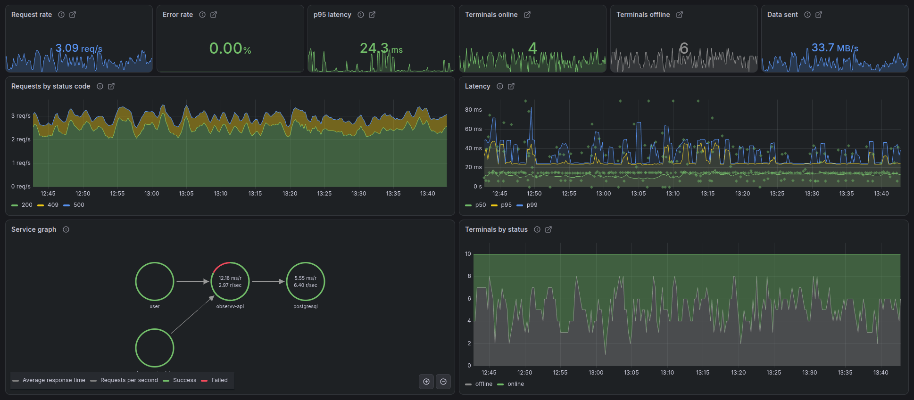

# observv

A demo of the Grafana observability stack (LGTM: Loki, Grafana, Tempo, Mimir).

A Go API and a simulated fleet of terminals send traces, metrics and logs over OTLP. Grafana is provisioned with datasources, dashboards and SLO alerts. Traces, metrics and logs link to each other. A chaos mode adds latency and errors to trigger an alert.



## Quick start

```sh
make up
```

Open http://localhost:3000 and log in as `admin` / `admin`.

```sh
make chaos-on   # 300 ms latency and 20% errors
make chaos-off
make down
```

## Architecture

- The simulator calls the API over HTTP. Each trace starts in the simulator and continues through the API to each SQL query.
- Alloy is the only collector. It pushes metrics to Mimir, so no Prometheus server is needed.
- The Mimir ruler evaluates the SLO recording rules and burn-rate alerts.
- The `stack/` directory is self-contained and can be copied into other projects.
- Fleet metrics use a `terminal.id` label. With 10 terminals, the cost is low. For unbounded IDs, such as user IDs, use traces and logs instead of metric labels.

## Alerting

Run `make chaos-on`. After about 7 minutes, `ApiAvailabilityFastBurn` fires. The alert shows on the **SLO** dashboard and in Grafana Alerting. Run `make chaos-off` to resolve it.

## Development

Run the Go code on the host, with the database and the stack in Docker:

```sh
cp .env.example .env
make db stack-up
make migrate-up seed
make run       # terminal 1
make simulate  # terminal 2
```

```sh
make test     # unit and integration tests (integration tests need Docker)
make lint
make sqlc     # regenerate the database code from the SQL queries
make mock     # regenerate mocks
```

`make mock` and `make lint` need [mockery](https://github.com/vektra/mockery) v3.8+ and [golangci-lint](https://golangci-lint.run) v2 built with Go 1.27 or newer.
